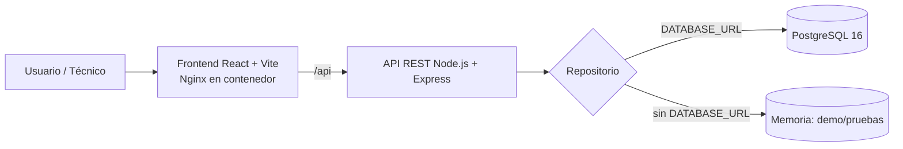
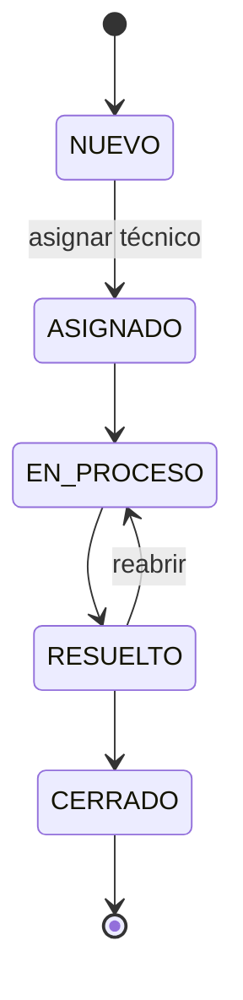

# Arquitectura

## Contexto
IT Incident Hub reemplaza reportes de incidentes dispersos (llamadas, mensajería, correo) por una aplicación web trazable.

## Diagrama

## Componentes
| Componente | Tecnología | Responsabilidad |
|---|---|---|
| frontend/ | React 18, Vite 5 | Formulario, listado con filtros, detalle con bitácora, dashboard |
| backend/ | Node 20, Express 4 | API REST, validaciones, reglas de negocio (estados) |
| backend/src/repositories | pg / memoria | Acceso a datos intercambiable |
| database/ | PostgreSQL | Esquema (`01_schema.sql`) y datos semilla (`02_seed.sql`) |
| tests/ | Jest + Supertest | Pruebas de integración de la API |
| devops/ | Scripts, CSV de backlog | Automatización de apoyo (smoke test, versión) |

## Capas del backend
`routes` (HTTP) → `services` (reglas de negocio y validación) → `repositories` (persistencia).

## Modelo de datos
- `technicians(id, name)`
- `incidents(id, title, description, category, priority, reporter, status, technician_id, created_at, updated_at)`
- `comments(id, incident_id, author, text, type, created_at)` — `type` = `COMENTARIO` o `SISTEMA` (bitácora automática).

## Ciclo de vida del incidente

## Decisiones (ADR resumidas)
1. **Node + Express**: stack liviano; el PDF no califica una tecnología específica.
2. **Repositorio intercambiable**: permite pruebas rápidas en CI sin base de datos.
3. **PostgreSQL con scripts SQL**: simple y reproducible con Docker Compose.
4. **Sin autenticación (v1.0.0)**: se registra como deuda técnica DT-03.
